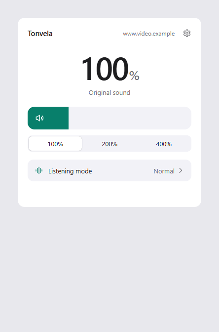
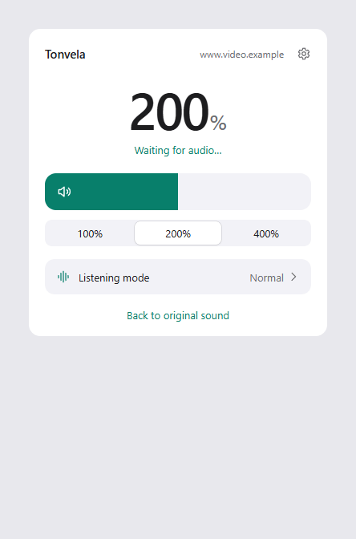
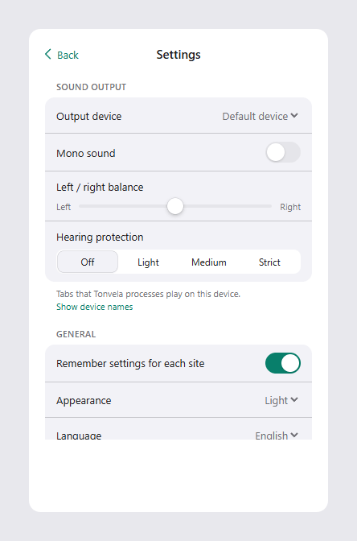

# Tonvela

**Her videoda dengeli ses.**
Sekme sesini yükselten, dengeleyen ve netleştiren Chrome eklentisi — tamamen cihazınızda çalışır.

[İndir](https://github.com/isolmaz/tonvela-chrome/releases/latest/download/Tonvela-Chrome.zip) · [Değişiklikler](CHANGELOG.md) · [Gizlilik](PRIVACY.md) · [Lisans](LICENSE)

[English](README.md) · **Türkçe**

  

## Nasıl çalışır

<table>
<tr>
<td width="33%" align="center"></td>
<td width="33%" align="center"></td>
<td width="33%" align="center"></td>
</tr>
<tr>
<td align="center"><b>1. Sesi aç</b> Çubuğu sürükle ya da %100, %200 veya %400'ü seç. Ses değişince Tonvela başlar; <i>Orijinal sese dön</i> geri alır.</td>
<td align="center"><b>2. Sesin karakterini seç</b> Dengeli yüksek ve kısık bölümleri eşitler, Konuşma sesleri öne çıkarır, Gece tepeleri yumuşatır.</td>
<td align="center"><b>3. Kendine göre ayarla</b> Çıkış cihazı, mono, denge, kulak koruma, site hafızası, tema ve dil.</td>
</tr>
</table>

## Özellikler

- **%400'e kadar ses**, ileriye bakan tepe sınırlayıcıyla.
- **Dinleme modları:** Normal, Dengeli, Konuşma, Gece, Müzik ve deneysel **Sadece ses** (cihazda çalışan [GTCRN](https://github.com/Xiaobin-Rong/gtcrn) modeli, mono, ~50 ms gecikme).
- **Bu seviyeyi koru:** duyduğun seviye hedef olur; geri alınabilir.
- **Çıkış cihazı:** işlenen sekmeleri seçtiğin hoparlör veya kulaklıktan çal.
- **Mono ses** ve **sol / sağ denge**; tek kulaklıkla ya da iki kulağın farklı duyduğu durumlarda kullanışlı.
- **Kulak koruma:** tepe sesler her ses seviyesinde Hafif (−3 dB), Orta (−6 dB) veya Sıkı (−12 dB) sınırın altında kalır.
- **Her sitenin ayarlarını hatırla** (yalnızca alan adı).
- **Kısayollar:** <kbd>Alt</kbd>+<kbd>Shift</kbd>+<kbd>V</kbd> Tonvela'yı açar, <kbd>Alt</kbd>+<kbd>Shift</kbd>+<kbd>↑</kbd>/<kbd>↓</kbd> sesi değiştirir.
- **English, Türkçe, Español, Português (Brasil) ve العربية** (sağdan sola); sistem / açık / koyu tema.

## Kurulum

1. [`Tonvela-Chrome.zip`](https://github.com/isolmaz/tonvela-chrome/releases/latest/download/Tonvela-Chrome.zip) dosyasını indirip bir klasöre çıkar.
2. `chrome://extensions` sayfasını aç ve **Geliştirici modu**nu aç.
3. **Paketlenmemiş öğe yükle**'ye tıkla ve çıkardığın klasörü seç.
4. Bir video sekmesinde Tonvela'yı aç, ses çubuğunu sürükle ya da bir seviye seç.

## Gizlilik

Ses tarayıcında işlenir ve dışarı çıkmaz. Sunucu, hesap, analiz veya kayıt yok. Mikrofon yalnızca çıkış cihazı adlarını görmek istersen istenir ve hemen kapatılır. Tercihler `chrome.storage.local` içinde kalır. Ayrıntılar: [PRIVACY.md](PRIVACY.md).

## Geliştirme

Node.js 22+ ve Python 3 gerekir; eklentinin derleme adımı yoktur (`extension/` klasörünü **Paketlenmemiş öğe yükle** ile açın). Komutlar ve testler için [İngilizce README](README.md#development) dosyasına bakın.

**Katkı:** `main`'e PR açın ve kullanıcıya dönük değişiklikleri [CHANGELOG.md](CHANGELOG.md) içindeki `## Unreleased` başlığı altına yazın. Sürüm numarasını değiştirmeyin; sürüm yayınlanırken belirlenir.

## Lisans

[MIT](LICENSE). Pakete dahil üçüncü taraf bileşenler (GTCRN, gtcrn-wasm, pffft) kendi lisanslarını korur; bkz. [THIRD_PARTY_NOTICES.txt](extension/THIRD_PARTY_NOTICES.txt).
